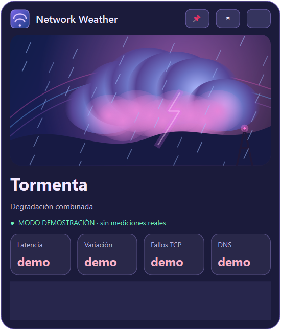

# Network Weather

Windows desktop network weather monitor. **Current state: development snapshot.** This repository provides real DNS, TCP and HTTPS probes, adapter snapshots, weather rules, local SQLite history, incident tracking, a CLI, a Windows widget, tray integration, expanded panel and eight procedural scenes. Visual polish and several diagnostics are still pending.

## Setup (PowerShell, Python 3.12+)

```powershell
cd .\NetworkWeather
py -3.12 -m venv .venv
.\.venv\Scripts\Activate.ps1
python -m pip install -e ".[dev,desktop]"
network-weather --once
network-weather-desktop --demo
network-weather-desktop
python -m pytest
python -m ruff check .
```

By default, one round checks `example.com` and `www.wikipedia.org` with OS DNS resolution, a TCP connection to port 443, and a verified HTTPS `HEAD /` request. The default interval is 30 seconds. Use repeatable `--destination` arguments to change targets. No response body is downloaded. Results and classifications are saved to `%LOCALAPPDATA%\NetworkWeather\history.db`; use `--raw` to avoid storage. The app does not change network settings.

The desktop starts monitoring in a worker thread. Close or minimize the widget to keep monitoring in the system tray; choose **Exit** from the tray menu to stop. `--demo` cycles all eight visual states without network requests or synthetic history. Settings, widget position and imported weather images persist under `%LOCALAPPDATA%\NetworkWeather`.

Current development preview (visual demo, no measured values): 

The DNS resolver may cache answers and has an OS-controlled timeout. Socket local addresses are matched to adapters when unambiguous; other routes remain unknown. Failed probes have no fabricated latency. TCP/HTTPS failure percentages are protocol-specific and are not IP packet-loss measurements. See [README_ES.md](README_ES.md) for metrics, limitations and the implementation sequence.
