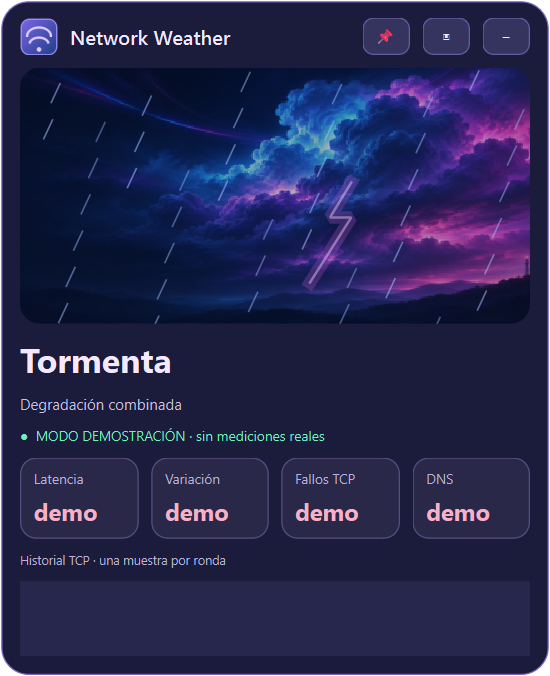

# Network Weather

Windows desktop network weather monitor. **Current state: development snapshot.** This repository provides real DNS, TCP and HTTPS probes, adapter snapshots, weather rules, local SQLite history, incident tracking, a CLI, a Windows widget, tray integration, expanded panel and eight procedural scenes. Visual polish and several diagnostics are still pending.

## Setup (PowerShell, Python 3.12+)

```powershell
cd .\NetworkWeather
py -3.12 -m venv .venv
.\.venv\Scripts\Activate.ps1
python -m pip install -e ".[dev,desktop]"
network-weather --once
network-weather-desktop --demo
network-weather-desktop
python -m pytest
python -m ruff check .
```

By default, one round checks `example.com` and `www.wikipedia.org` with OS DNS resolution, a TCP connection to port 443, and a verified HTTPS `HEAD /` request. The default interval is 30 seconds. Use repeatable `--destination` arguments to change targets. No response body is downloaded. Results and classifications are saved to `%LOCALAPPDATA%\NetworkWeather\history.db`; use `--raw` to avoid storage. The app does not change network settings.

An optional **Direct TCP probe without DNS** accepts a globally reachable numeric IP of a server that accepts TCP/443 (`--direct-ip IP` in the CLI). It makes no DNS or HTTPS request for that address. A successful connection is independent evidence of external connectivity, so repeated DNS failures with direct TCP success can be classified as Foggy without claiming an Internet outage. A failed optional IP probe alone does not establish an outage. It is off by default, and literal IPs are rejected as DNS destinations. The direct probe has its own Diagnostics row and does not affect compact hostname cards or chart; filtered history retains its identifiable TCP result. See Python's [IP address classification](https://docs.python.org/3.12/library/ipaddress.html) and [socket documentation](https://docs.python.org/3.12/library/socket.html).

The desktop starts monitoring in a worker thread. Close or minimize the widget to keep monitoring in the system tray; choose **Exit** from the tray menu to stop. `--demo` cycles all eight visual states without network requests or synthetic history. Settings, widget position and imported weather images persist under `%LOCALAPPDATA%\NetworkWeather`.

Weather images and animated effects are independent. Each weather state can use an imported PNG, JPG or WebP (up to 10 MB and 4096 pixels per dimension), copied without modifying the original. The importer checks existence, format and dimensions before decoding. Image fit, effects and reduced motion apply immediately to the widget, overview and previews.
Sunny and cloudy scenes have subtle ambient motion. Animation pauses for hidden scenes, static previews, offline/unknown states, and whenever effects are disabled or reduced motion is enabled.
Changing probe destinations takes effect after restarting the app. The new destinations begin a fresh classification window; older measurements remain available in history, and any previous active incident is closed as a context change without asserting recovery.
If a DNS answer contains multiple addresses, TCP and HTTPS each try the preferred address and at most one distinct alternative on failure, favoring the other IP family when available. A successful result reports the measured time for its successful attempt; retry details are retained without creating extra samples in the weather calculation.

The history panel offers one hour, 24-hour, 7-day, 30-day and custom ranges, with a destination filter for TCP latency. Weather is shown as observed categorical states; the separate latency chart contains only valid TCP samples averaged within time bins. Unobserved periods remain visible. SQLite history queries run in a worker thread.

The compact widget chart switches between **Latency** and **Variation** and remembers the choice. It shows real timestamps for the last 30 rounds, including stored rounds from before launch. Each latency point averages successful TCP samples in its round. Variation averages absolute changes for the same destinations in adjacent successful rounds; failures and long pauses break comparison. Missing samples are neither plotted nor joined.

If a saved widget position is outside all current displays, such as after unplugging a monitor, opening the widget brings it back into the visible area.

**Start with Windows** is off by default. Enabling it adds a command only to the current user's `HKCU\Software\Microsoft\Windows\CurrentVersion\Run` entry; disabling it removes that entry. The checkbox reads the actual registry state, and warns when an old installation path is registered. Source installs use `pythonw.exe` when available; the packaged app uses its own executable. See [Microsoft's Run key documentation](https://learn.microsoft.com/en-us/windows/win32/setupapi/run-and-runonce-registry-keys).

Selecting an incident displays its start, end, duration, peak severity and latest persisted evidence. The UI leaves the cause unidentified when the available probes cannot establish it.

Choose **Settings → Language** to switch between Spanish and English. Restart the app to apply the saved choice. Raw error messages from Windows or external servers may retain their original language.

A Windows preview ZIP has been built with PyInstaller, including the eight scene images. It still needs validation on a clean Windows machine before a public release.

Current development preview (visual demo, no measured values): 

Expanded overview layout with **synthetic values for visual review only**: 

Technical Diagnostics layout with **synthetic values for visual review only**: 

The overview shows the current weather scene, six observed status cards, the last hour of saved weather and TCP history, the active incident and supporting evidence. Its SQLite history query runs outside the UI thread. TCP failures, DNS status, gateway ICMP replies and confirmed external connectivity remain distinct from IP packet loss or an attributed root cause.

Technical Diagnostics shows comparable recent samples by destination and protocol: attempts, successes, median, nearest-rank P95, variation and failures. Variation averages absolute differences between adjacent successful probe times for that destination and protocol. TCP connection-time variation is neither ICMP RTT nor one-way jitter. Failed probes do not contribute a duration, and pauses or route changes start a new comparison window.

The DNS resolver may cache answers and has an OS-controlled timeout. Socket local IPv4/IPv6 addresses are matched to adapters when unambiguous; other routes remain unknown. A cached, read-only Windows query identifies the IPv4 gateway, followed by an ICMP echo check when available. ICMP success has no fabricated RTT, and missing echo does not prove a local outage. TCP/HTTPS failure percentages are protocol-specific and are not IP packet-loss measurements. See [README_ES.md](README_ES.md) for metrics, limitations and the implementation sequence.

The offline state requires two complete rounds of failed TCP and HTTPS probes across all configured destinations. A cached DNS answer does not overrule that evidence, while missing probes and TLS errors cannot confirm it. Latency baselines are kept per destination; one slow destination alone does not label the whole connection as slow.

After a monitoring gap longer than three configured intervals (at least two minutes), the classification window and recent latency baseline reset. A previous incident ends at its last observed sample with an interruption note, without claiming recovery during the gap.

On Windows, Diagnostics can show Wi-Fi signal quality (%), RSSI (dBm) and channel for connected wireless interfaces when Native Wi-Fi provides them. The app caches this read-only context for 60 seconds and does not scan nearby networks or request SSID/BSSID. A listed Wi-Fi interface is not automatically attributed to the probes' route. Unsupported fields remain absent, and Wi-Fi signal is not used to assign an Internet fault cause. See Microsoft's [Native Wi-Fi query API](https://learn.microsoft.com/en-us/windows/win32/api/wlanapi/ne-wlanapi-wlan_intf_opcode) and [location access changes](https://learn.microsoft.com/en-us/windows/win32/nativewifi/wi-fi-access-location-changes).
