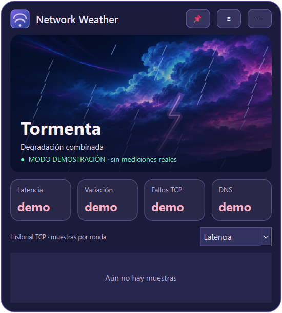
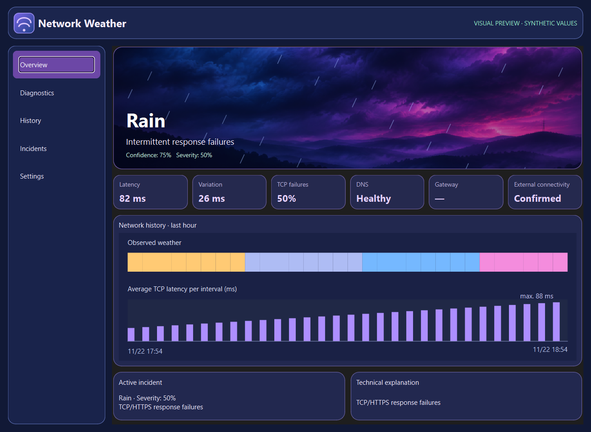
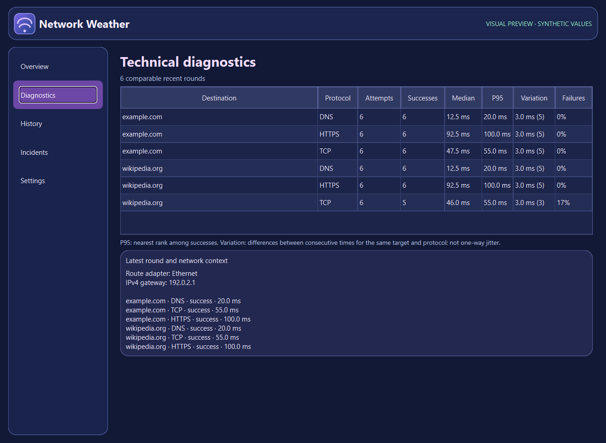

# Network Weather

Aplicación de escritorio para Windows que representa el estado de Internet como clima. **Estado actual: vista previa de desarrollo.** Contiene sondas, reglas meteorológicas, historial SQLite, CLI, widget, bandeja, panel expandido y ocho escenas procedurales. Antes de publicar una versión final falta la prueba interactiva del ejecutable en un Windows limpio. Las capturas de referencia son maquetas: sus cifras no son datos de esta aplicación.

La [guía de uso en español](docs/USER_GUIDE_ES.md) reúne los controles, la configuración y el significado de los climas. También está disponible [en inglés](docs/USER_GUIDE.md).
La [lista de validación en Windows](docs/RELEASE_CHECKLIST.md) indica las comprobaciones interactivas pendientes antes de publicar una versión final.

## Arquitectura

`probes` realiza pruebas DNS, TCP y HTTPS; `collector` reúne una ronda; `metrics` calcula estadísticas de muestras comparables. `weather` clasifica con reglas y evidencias, `history` guarda rondas e incidentes en SQLite y `desktop` presenta los datos con PySide6. Las sondas y las consultas del historial se ejecutan en hilos separados del gráfico.

## Instalación y uso (PowerShell, Python 3.12+)

```powershell
cd .\NetworkWeather
py -3.12 -m venv .venv
.\.venv\Scripts\Activate.ps1
python -m pip install -e ".[dev,desktop]"
network-weather --once
network-weather-desktop --demo
network-weather-desktop
python -m pytest
python -m ruff check .
```

`network-weather --once` guarda una ronda y su clasificación en `%LOCALAPPDATA%\NetworkWeather\history.db`. Sin `--once`, emite una ronda JSON por línea cada 30 segundos. `--raw --once` realiza sondas sin guardar historial. `--destination` es repetible, pero la clasificación permanece «desconocido» si solo hay un destino. `Ctrl+C` termina. El intervalo permitido es de 5 a 3600 segundos y el timeout TCP/HTTPS de 0,2 a 30 segundos.

`network-weather-desktop` abre el widget y empieza a medir en un hilo separado. El botón central abre el panel, el botón de minimizar lo oculta en la bandeja y **Salir** en el menú de bandeja detiene el hilo. El cierre del widget también lo oculta. El historial permite elegir una hora, 24 horas, 7 días, 30 días o un rango personalizado y filtrar la latencia TCP por destino. La franja de clima muestra estados categóricos observados; el gráfico inferior promedia solo latencias TCP válidas por intervalo y deja visibles los periodos sin observación. La consulta SQLite se realiza fuera del hilo gráfico. `--demo` recorre los ocho climas sin hacer sondas ni escribir muestras; todas las tarjetas muestran «demo». La posición, fijación, imágenes y preferencias se guardan en `%LOCALAPPDATA%\NetworkWeather\settings.ini`.

La gráfica del widget compacto permite elegir **Latencia** o **Variación** y recuerda la elección. Su eje horizontal usa las horas reales de las últimas 30 rondas, incluidas las guardadas antes de abrir la aplicación. Cada punto de latencia promedia los éxitos TCP de la ronda. La variación compara cada destino con su valor en la ronda inmediatamente anterior y promedia esas diferencias absolutas; los fallos y las pausas largas cortan la comparación. Las muestras ausentes quedan sin punto y no se unen por una línea.

Si la posición guardada del widget queda fuera de las pantallas disponibles (por ejemplo, al desconectar un monitor), la aplicación lo devuelve al área visible al abrirlo.

Puedes arrastrar la esquina inferior izquierda del widget para cambiar su tamaño. El tamaño elegido se conserva al reiniciar. Durante las primeras mediciones puede aparecer «Desconocido» aunque las tarjetas ya tengan cifras: la descripción indica el avance hasta tres rondas y, después, la confirmación del clima con otra medición.
Al cambiar el tamaño, las escenas recargan sus imágenes en una resolución adecuada por pasos para conservar nitidez sin mantener en memoria el archivo completo en las vistas previas pequeñas.
El ajuste «Cubrir» tiene en cuenta el ancho y el alto, incluso en widgets altos y estrechos; «Centrar» conserva el tamaño original en píxeles.
El intervalo configurado se cuenta entre los inicios de las rondas de medición. Si las pruebas duran más que ese intervalo, la ronda siguiente espera brevemente antes de empezar. Cada muestra conserva su hora real.

**Iniciar con Windows** está desactivado por defecto. Al activarlo, Network Weather registra únicamente un comando para el usuario actual en `HKCU\Software\Microsoft\Windows\CurrentVersion\Run`; al desactivarlo elimina su entrada. La casilla lee el registro real al abrir Configuración. Si la ruta registrada pertenece a otra instalación, avisa para que el usuario pueda desactivar y activar la opción y actualizarla. En una instalación Python usa `pythonw.exe` cuando está disponible; el ejecutable empaquetado usa su propia ruta. [Documentación de Microsoft sobre Run](https://learn.microsoft.com/en-us/windows/win32/setupapi/run-and-runonce-registry-keys).

En **Configuración → Idioma**, elige Español o English. La preferencia se aplica al reiniciar la aplicación y se conserva para las siguientes sesiones. Los mensajes técnicos devueltos por Windows o por un servidor externo pueden aparecer en el idioma original de ese sistema.

Vista actual del widget en modo demostración: 

Vista del resumen expandido con **valores sintéticos solo para revisar el diseño**: 

Vista del diagnóstico técnico con **valores sintéticos solo para revisar el diseño**: 

El resumen presenta la escena meteorológica, seis tarjetas de estado, el historial observado de la última hora, el incidente activo y sus evidencias. La gráfica se consulta en SQLite desde un hilo separado; en funcionamiento normal solo muestra rondas y latencias guardadas. Las tarjetas distinguen fallos TCP, estado DNS, respuesta ICMP de la puerta de enlace y conectividad externa confirmada sin convertirlos en pérdida IP ni atribuir causas no medidas.
Las escenas Soleado y Nublado tienen movimiento ambiental suave. La animación se pausa al ocultar una escena, en las vistas previas estáticas, en los estados Sin conexión/Desconocido y al desactivar efectos o activar movimiento reducido.
Los cambios de clima se funden brevemente entre escenas en el widget y el resumen. La transición se omite cuando está activado el movimiento reducido o los efectos visuales están desactivados.

En la gráfica compacta, los extremos muestran segundos cuando el intervalo visible es menor de dos minutos, para distinguir mediciones cercanas. DNS correcto y cero fallos TCP observados se muestran en verde; la falta de respuesta ICMP de la puerta de enlace conserva un color neutro porque puede estar filtrada.

Cuando hay varios fenómenos confirmados, el resumen muestra el principal y las señales adicionales. Un clima aún pendiente de confirmación se identifica por separado y no se presenta como fenómeno secundario.

## Qué se mide

Cada ronda consulta por defecto `example.com` y `www.wikipedia.org`. Para cada destino hace una resolución DNS del sistema, una conexión TCP al puerto 443 y una solicitud HTTPS `HEAD /` con TLS verificado. Es una solicitud pequeña; no descarga el cuerpo. Una respuesta HTTP válida, incluso 4xx/5xx, confirma conectividad HTTP y conserva el código recibido. El usuario puede cambiar los destinos con `--destination` (repetible). No se modifica la configuración de red.
Si DNS devuelve varias direcciones y falla la preferida, TCP y HTTPS prueban como máximo una alternativa distinta, priorizando la otra familia IP cuando existe. Se conserva el detalle del reintento, pero la latencia exitosa corresponde solo al intento que respondió y el reintento no se cuenta como una muestra adicional del clima.
En Windows, si falla HTTPS directo se hace también una solicitud `HEAD` verificada mediante WinHTTP y su ruta automática, que puede usar el proxy configurado por el usuario. El detalle identifica este respaldo sin atribuirle una IP remota ni local del socket directo. Solo una respuesta 2xx/3xx lo confirma: un error generado por el proxy no prueba conectividad con el origen. Si el DNS local falla pero HTTPS por esta ruta responde repetidamente, el motor puede mostrar Neblina. [Documentación de Microsoft sobre proxy automático en WinHTTP](https://learn.microsoft.com/en-us/windows/win32/api/winhttp/nf-winhttp-winhttpopen).

Opcionalmente se puede configurar **Prueba TCP directa sin DNS** con una IP pública de un servidor que acepte conexiones en el puerto 443 (o `--direct-ip IP` en la CLI). No se consulta DNS ni se hace HTTPS para esa dirección. Un éxito confirma que al menos esa conexión externa funcionó; un fallo aislado no prueba una caída general. Si fallan de forma persistente las resoluciones de dominios pero esta sonda responde, el diagnóstico puede mostrar Neblina con ambas evidencias y evita declarar «Sin conexión». La prueba está desactivada por defecto. Las direcciones privadas y las IP escritas como destinos DNS se rechazan para no presentar una IP literal como una resolución. La sonda directa tiene su propia fila en Diagnóstico; no se mezcla con las tarjetas ni la gráfica compacta de los dominios. El historial filtrable sí conserva todas las sondas TCP con su destino identificable. [Clasificación de IP global de Python](https://docs.python.org/3.12/library/ipaddress.html), [API de sockets de Python](https://docs.python.org/3.12/library/socket.html).

Las duraciones de sondas fallidas son `null`. La latencia TCP excluye la resolución DNS; la duración HTTPS abarca TCP, TLS y respuesta HTTP. `metrics.summarize` calcula mediana, percentil 95 por rango más cercano, porcentaje de pruebas fallidas y variación como el promedio de diferencias absolutas entre éxitos consecutivos del mismo destino y protocolo. La variación TCP describe tiempos de conexión y no equivale a RTT ICMP ni a jitter unidireccional. El diagnóstico expone intentos, éxitos y pares usados para cada cifra. Las estadísticas de tráfico del adaptador son contadores locales; su `speed_mbps` es velocidad negociada del enlace, no velocidad de Internet.

En Windows, el diagnóstico puede mostrar calidad de señal Wi‑Fi (%), RSSI (dBm) y canal de interfaces inalámbricas conectadas cuando Native Wi‑Fi los proporciona. La consulta se guarda en caché durante 60 segundos y no realiza escaneos ni solicita SSID/BSSID. La interfaz Wi‑Fi mostrada no se identifica automáticamente como la ruta de las sondas; los campos no disponibles quedan ausentes. La consulta de calidad en tiempo real puede no estar disponible en algunas versiones de Windows y entonces se intentan únicamente RSSI y canal. Esta información local no se usa para afirmar una causa de los problemas de Internet. [API de calidad de Microsoft](https://learn.microsoft.com/en-us/windows/win32/api/wlanapi/ne-wlanapi-wlan_intf_opcode), [privacidad y ubicación](https://learn.microsoft.com/en-us/windows/win32/nativewifi/wi-fi-access-location-changes).

## Límites actuales

- La resolución DNS usa el resolvedor de Windows, que puede responder desde caché y controla su propio timeout. Por ello su tiempo no mide siempre una consulta remota y un bloqueo largo del resolvedor puede prolongar una ronda.
- Los sockets registran su dirección IP local IPv4 o IPv6 y se compara con los adaptadores. `route_adapter` queda `null` si no hay correspondencia única, por ejemplo con algunas VPN o varias interfaces. Al cambiar la interfaz identificada, el motor reinicia su ventana de clasificación.
- Windows informa la puerta de enlace IPv4 del adaptador mediante una consulta de solo lectura, almacenada durante cinco minutos. Si se identifica, la aplicación envía un eco ICMP por ronda. Registra únicamente si recibió respuesta: no inventa un tiempo RTT. La ausencia de eco puede deberse a filtrado y por sí sola no demuestra una falla local.
- No se infiere pérdida de paquetes IP de fallos TCP/HTTPS. El porcentaje de fallos siempre pertenece a un protocolo y destino concretos.
- Si DNS local falla, no se crean resultados ficticios de TCP; una respuesta HTTPS solo se registra si WinHTTP realizó realmente la solicitud por la ruta de Windows. Tampoco se infiere conexión estable cuando faltan muestras.
- La clasificación exige tres rondas, dos destinos y dos clasificaciones candidatas consecutivas para cambiar de clima. Los incidentes quedan abiertos durante resultados desconocidos y cierran tras dos rondas soleadas. La causa permanece sin atribuir.
- Tras una interrupción de más de tres intervalos configurados (mínimo dos minutos), el motor descarta su ventana y su línea base recientes. La primera ronda nueva se clasifica como desconocida hasta reunir evidencia suficiente. Un incidente anterior termina en la última medición previa con la nota «monitoreo interrumpido»; esto no afirma que la conexión se recuperó durante la pausa.
- La línea de tiempo conserva un clima solo durante la cadencia de muestras observada; un periodo más largo sin mediciones queda marcado como no observado.
- Al cambiar los destinos y reiniciar la aplicación, el motor inicia una ventana de clasificación nueva. El historial anterior permanece disponible; un incidente previo se cierra en la última medición con una nota de cambio de contexto, sin afirmar recuperación.
- El plazo de retención configurado se aplica al iniciar y cada hora mientras el monitor sigue activo, para limitar el crecimiento de SQLite durante sesiones largas.
- «Sin conexión» requiere dos rondas completas sin respuesta TCP ni HTTPS de todos los destinos configurados. Una respuesta DNS, que puede venir de caché, no descarta ese estado; un fallo aislado, una prueba ausente o un error TLS tampoco lo confirman. La latencia se compara con una línea base propia de cada destino y la latencia alta de un único destino no se presenta como degradación general.
- El motor de clima aún usa umbrales iniciales conservadores. Falta validar su comportamiento con conjuntos de datos reales de varios tipos de conexión antes de considerarlo diagnóstico definitivo.
- El panel muestra historial por rango, latencia TCP por destino, puerta de enlace, datos Wi‑Fi disponibles e incidentes con inicio, fin, duración, severidad y evidencias. La confianza del clima y la confianza en una causa aparecen por separado. Si las sondas no permiten identificar una causa, esta última queda «no establecida»; no se atribuye ninguna causa a un proveedor.
- Los ocho fondos predeterminados son ilustraciones propias creadas para este proyecto. Qt dibuja encima los efectos de lluvia, viento, niebla y relámpagos, que pueden apagarse sin perder la imagen. Cada clima acepta una imagen PNG, JPG o WebP de hasta 10 MB y 4096 px, copiada al área de datos sin modificar el original. El importador verifica existencia, formato y dimensiones antes de decodificar. Cambiar imagen, ajuste, efectos o movimiento reducido actualiza de inmediato el widget, el resumen y las vistas previas.
- Existe un ZIP de vista previa para Windows generado con PyInstaller. Los envíos correctos a `main` dejan además una vista previa descargable en los [artefactos de la CI](https://github.com/santiagorestrepo14/Network_Weather/actions/workflows/ci.yml). Descarga el artefacto de una ejecución exitosa, descomprímelo y abre `NetworkWeather.exe --demo` para revisar las escenas o `NetworkWeather.exe` para sondear la red. Los artefactos se conservan 30 días. El paquete aún necesita validación interactiva en un Windows limpio antes de considerarse instalador público.

## Secuencia

1. **A:** modelos, sondas, métricas básicas, CLI y pruebas.
2. **B:** línea base, reglas de clima, diagnóstico explicable, incidentes e historial SQLite.
3. **C:** widget, bandeja y panel PySide6 con monitoreo fuera del hilo gráfico (base funcional).
4. **D:** ocho escenas, animaciones y personalización segura de imágenes (base funcional; pulido pendiente).
5. **E:** integración, pruebas en Windows, documentación completa, CI y ejecutable.

El código de desarrollo se publica en este repositorio. Las vistas previas de CI permiten revisar cada versión de `main`; todavía no hay una versión final.
